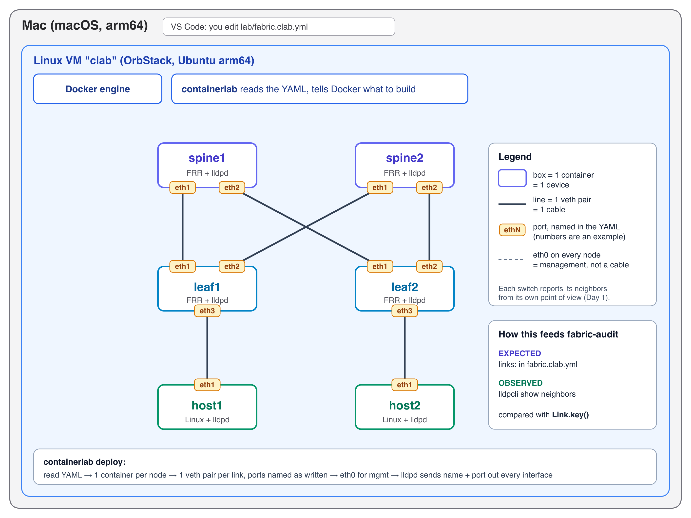
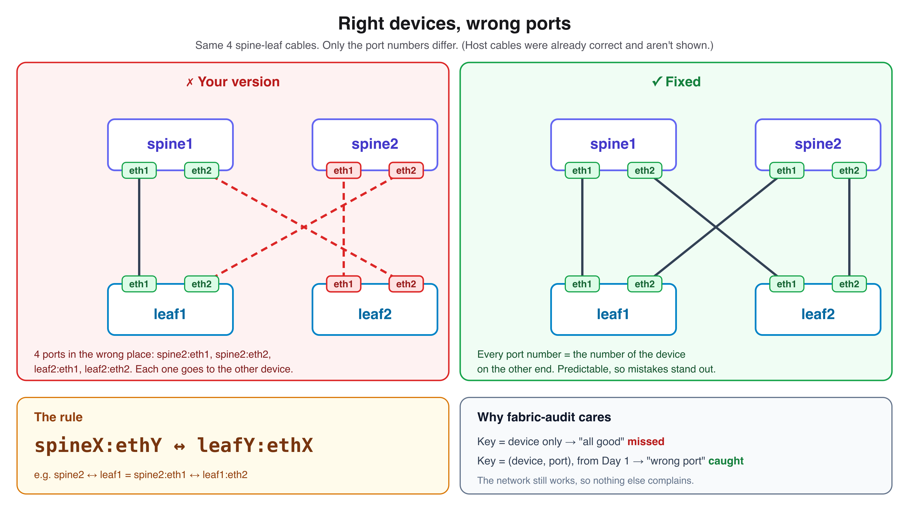

# FA-2 · Build a virtual data center fabric

**Sprint:** Offer Sprint · Day 2 · ⏱️ ~90 min
**Type:** Story · **Priority:** High

---

## 📖 The story

> 💬 **Your lead:**
> "We can't test an audit tool on real racks. Build a small fabric on your laptop,
> with switches that can tell you who they're plugged into."

**As an** audit engineer
**I want** a lab fabric that reports its own cabling over LLDP
**So that** fabric-audit has real "observed" data to compare against the plan

---

## 🏗️ What you're building



- **containerlab** reads a YAML file and builds the lab: one **container** per device, one **veth pair** per cable.
- **FRR** is the switch software on the spines and leaves.
- **lldpd** runs on every node. Each one says "I'm spine1, port eth1" and records what it hears back.
- It all runs in a small **Linux VM** (OrbStack), because containerlab needs Linux.

**How this feeds fabric-audit:** the YAML `links:` are the **expected** cabling, `lldpcli show neighbors` gives the **observed** cabling, and Day 3+ compares the two.

---

## 🎓 Learning goals

By the end I can explain:
- what containerlab creates for each device and each cable
- what LLDP does, and what it **can't** see
- why the topology file is basically a cabling plan

---

## ✅ Acceptance criteria

- [x] containerlab runs on my Mac
- [x] `lab/fabric.clab.yml` defines 2 spines, 2 leaves, 2 hosts (spines and leaves on FRR)
- [x] lldpd runs on every node
- [x] One command brings the lab up
- [x] `lldpcli show neighbors` on a leaf shows both spines

---

## 🧩 Tasks

- [x] 1. Install containerlab (one-time setup below)
- [x] 2. Write `lab/fabric.clab.yml`
- [x] 3. Deploy, `docker exec` into a leaf, run `lldpcli show neighbors`
- [x] 4. Commit and push

**One-time setup (Task 1):**
```bash
orb create ubuntu clab
orb -m clab                       # now inside the VM
curl -sL https://containerlab.dev/setup | sudo -E bash -s "all"
containerlab version              # ✅ prints a version
```

**Every day after that (from the repo folder):**
```bash
orb -m clab sudo containerlab deploy  -t lab/fabric.clab.yml   # up
orb -m clab sudo containerlab destroy -t lab/fabric.clab.yml   # down
```

---

## 🤔 Think about it

- My Mac is arm64. How do I check that an image is arm64 before I use it?
- Does the FRR image include lldpd? If not, how do I add it so it's still there after I redeploy?
- containerlab reserves `eth0` for management. Which ports do my cables use?

---

## 📚 Resources

- containerlab quickstart: https://containerlab.dev/quickstart/
- FRR images: https://quay.io/repository/frrouting/frr

---

## 📝 My notes

### ⚡ TL;DR: 5 things to remember
1. **containerlab = YAML → containers (devices) + veth pairs (cables).** It needs Linux, so on a Mac it runs in an OrbStack VM.
2. **`kind: linux`** = a plain container. FRR is just a Linux container that runs routing software.
3. **What makes a leaf a leaf is its cables,** not its software. All 4 switches run the same image.
4. **Port rule: `spineX:ethY ↔ leafY:ethX`.** The right devices in the wrong ports still "works", and that's exactly the bug fabric-audit must catch.
5. **`links:` = EXPECTED, `lldpcli show neighbors` = OBSERVED.** Day 3 onwards compares the two.

---

### 🏗️ Setup (decided once, then forgotten)
- containerlab needs Linux kernel features (network namespaces, veth pairs) that macOS doesn't have.
- **OrbStack Ubuntu VM "clab"** (arm64). containerlab and its own Docker live **inside** the VM. Docker Desktop isn't used.
- The VM sees my repo at the **same path**, so I edit in VS Code and run `orb -m clab sudo containerlab ...`.
- Which tool provides the VM doesn't matter for the project. Pick one and move on.

---

### 📄 The topology file, piece by piece

| Part | What it does | Note |
|---|---|---|
| `name: fabric` | Lab name → containers become `clab-fabric-<node>` | containerlab adds `clab-` itself, so don't repeat it in the name |
| `defaults: kind: linux` | Applies to **every** node | Say it once instead of 6 times |
| `kinds: linux: exec:` | Commands run in every linux node right after start | Installs and starts lldpd |
| `nodes:` | Only what differs per node (the image) | |
| `links:` | One line per cable: `["dev:port", "dev:port"]` | Never use `eth0` |

**Write each fact once, at the widest level where it's true.** The same idea comes back in Kubernetes and Terraform.

---

### 🪤 Mistakes I made (and what they taught me)

| Mistake | Why it's wrong | Lesson |
|---|---|---|
| `name: clab-fabric-spine` / `clab01` | containerlab adds `clab-` and the node name itself | The lab name says **what** the lab is |
| `kind: frrouting` | `kind` is a fixed containerlab list, not the software's name | FRR needs nothing special, so `linux` |
| `image: frr:10.7.1` | No registry means Docker Hub, but FRR is on **quay.io** | Full name = `registry/owner/repo:tag` |
| `kind: host` for servers | In containerlab, "host" = **the VM running the lab** | A tool can reuse a word you know with a different meaning |
| Only 4 links | Each spine reached only one leaf | Count first: 2 spines × 2 leaves + 2 hosts = **6** |
| Wrong port numbers | Right devices, wrong ports; still worked | Use a port **convention** so mistakes stand out |
| List directly under `linux:` | Missing the `exec:` key | YAML keys say what a list is for |
| Duplicate `spine2:` key | In YAML the later copy silently wins | Delete old blocks when you replace them |



---

### 🧰 Image basics
- **Pin tags** (`10.7.1`, not `latest`) so the lab comes up the same every time. Same idea as `uv.lock`.
- **Check the architecture before using an image:** `docker image inspect  -f '{{.Architecture}}'` should say `arm64` on an M1.
- The FRR image is Alpine-based and **doesn't include lldpd**, so `exec:` installs it on every deploy.
  - Tradeoff: it needs internet and adds a few seconds per deploy. Option for later: my own image (`FROM frr` + `apk add lldpd`), which is Day 7's Dockerfile skill.
- Anything typed by hand inside a container is **gone after a redeploy**. Put it in the YAML.

---

### 📡 What LLDP showed me
- Each switch reports neighbors **from its own side**: `leaf1:eth1 → spine1:eth1`. That's the Day 1 direction problem, now with real data.
- **LLDP needs a daemon on both ends.** With lldpd only on leaf1, it saw nothing.
- **Noise on `eth0`:** every node sees every other node there, because all `eth0` ports share one management network. That would mean 5 cables that don't exist, and 5 false "unexpected" alarms.
  - **My decision for Day 3: stop lldpd on `eth0` at the source** (`lldpd -I 'eth*,!eth0'`) instead of filtering in the collector. Bad data that never gets produced can't leak into later code.
- **`PortID` vs `PortDescr`:**
  ```
  PortID:     mac aa:c1:ab:31:5a:27   ← the ID LLDP sends for the port (here: its MAC)
  PortDescr:  eth1                    ← the human-readable port name
  ```
  - LLDP lets the sender pick **what kind of ID** to use for a port: a MAC address or an interface name. lldpd chose the MAC here.
  - My `Interface` model needs `port: "eth1"`, so the collector must use `PortDescr`, or lldpd must be told to send the name as the ID.
  - Open question for Day 3: which one, and why?

---

### 🎤 Interview angle
- "How did you test a cabling audit tool without hardware?" → containerlab, FRR, LLDP, and faults kept in version control.
- "Why did your lab report links that don't exist?" → the shared management network on `eth0`, so I stopped LLDP there.
- "Why a port-numbering convention?" → it makes cabling predictable, so a wrong port is visible at a glance.

---

## 🏁 Done when

The lab deploys with one command and LLDP neighbors show up. 🎉

**Next up → FA-3:** the collector, which turns LLDP neighbors into observed `Link`s.
